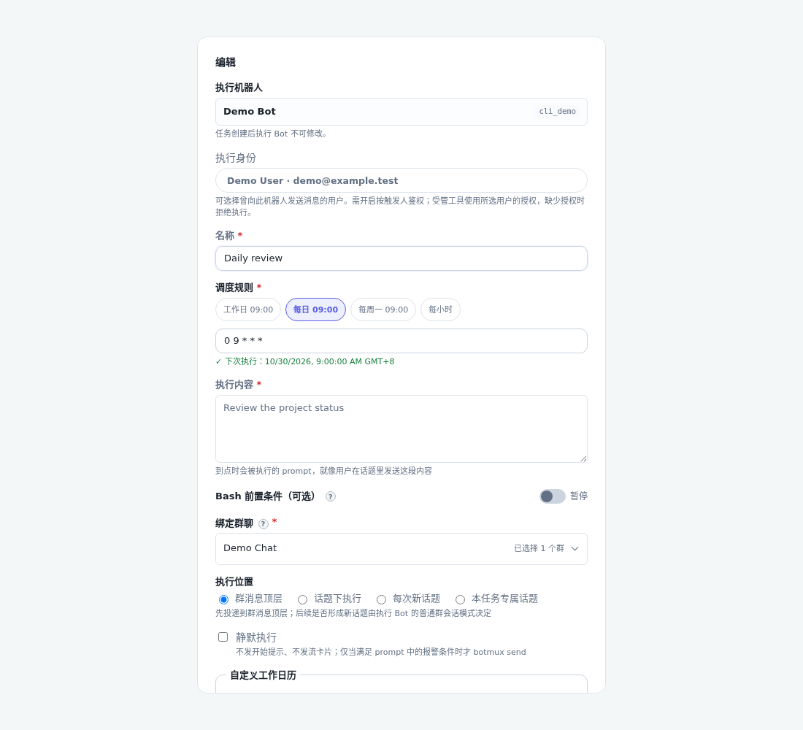
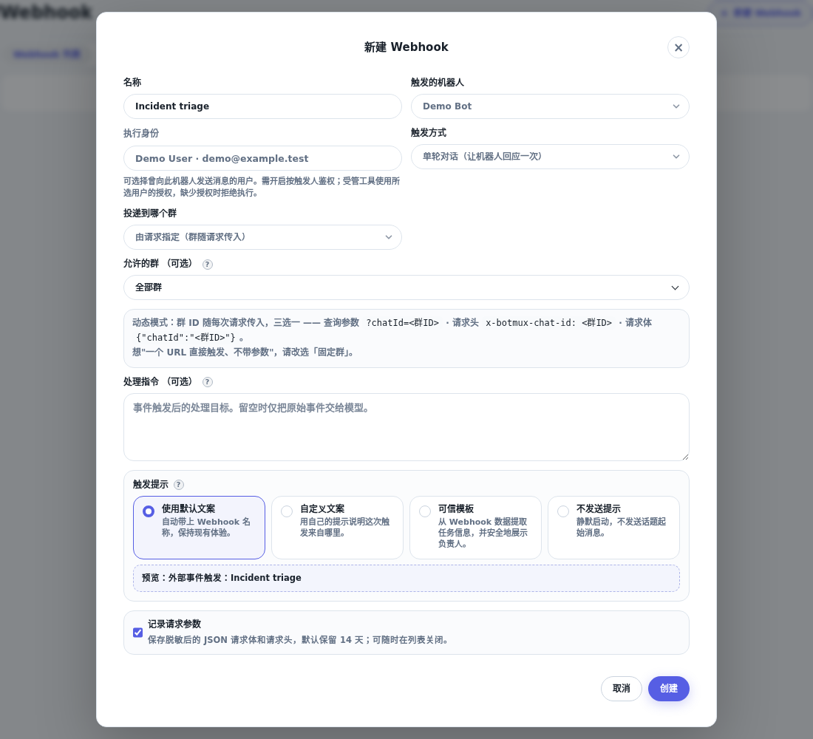

# Cron 与 Webhook 的执行身份

Dashboard 的定时任务及 Webhook 创建/编辑表单提供「执行身份 / Run as」。不选择用户时保持原有行为；选择后，每次执行携带该用户的身份，受管工具按现有本机个人授权或中心化平台授权取凭据，不复制凭据或借用机器账号。

候选人为曾向目标机器人发送消息的真人，包含历史会话 owner 和有真人发送者证据的回复者。单纯被 @、通讯录查询结果及机器人不作为使用记录。选项显示缓存的姓名、邮箱；没有姓名时显示 open_id。新消息事件持久化使用记录及 union_id，后续通讯录补全不覆盖使用记录。已有会话可补齐历史记录；既无发送记录也无保留会话的旧用户需要再次发送消息。

open_id 只在签发它的应用内有效，因此选项与保存的身份均绑定目标 Bot。切换 Bot 后重新选择；服务端只接受候选人的 open_id 并自行解析 union_id，忽略客户端传入的身份对象。Webhook 的 HTTP payload、headers、query 均不能指定执行者；目标 daemon 从保存的 connector 配置中读取选择。

## 前置条件与边界

目标 Bot 必须开启 `triggerUserAuth.enabled` 并配置至少一种受管工具。否则保存显式身份失败。`fallback` 是兼容配置，当前凭据发布链路无论其值为 `bot-identity` 还是 `none`，在缺少用户凭据时均拒绝调用；选择执行用户不要求修改该全局配置。所选用户也必须满足目标 Bot 的操作权限；每次执行重新检查，撤销权限后后续运行拒绝执行。

身份作用于配置中的受管工具（lark-cli、bytedcli、larkdev；Codebase CLI 随 bytedcli）以及传给 CLI/受管执行链的可信请求者。它不切换操作系统账号、AI 模型供应商账号，也不接管独立 MCP 服务的认证。工具仍需相应用户授权、应用 scopes 及资源访问权限；没有授权会拒绝该工具调用。lark-cli 的 bot/user 角色语义沿用现有应用绑定规则。

支持本机受管 PTY/Tmux 家族及其受管 RPC 会话。不支持 adopt、外接 App Server 或远端后端，避免在没有受管凭据包装器的执行环境中静默使用宿主登录态。向已有会话注入时核对 Worker 启动时冻结的鉴权设置；设置尚未生效的 Worker 需要先重启。显式指定身份的 Webhook 不允许 steer 合入别人的执行。

## 存储与生命周期

- 定时任务增加 `runAsUser: { larkAppId, openId, unionId, name? }`，保存在现有 host authority，并写入 JSON 投影及 canonical input。`ownerOpenId` / `ownerUnionId` 与 authority 的 control principal 继续记录创建者，编辑执行身份不改任务控制权。Delegated schedule 继续受原 grant 约束，不允许通过此字段替换身份。
- Webhook connector 使用同一 `runAsUser` 结构。创建/更新接口接受 `runAsOpenId`；空字符串/null 清除，省略保留原值。
- 每个执行轮次冻结身份，默认身份同样以 null 冻结。编辑任务或 connector 只影响未来执行，不改变已有队列、运行及 recovery 的身份；缺少必要快照时拒绝从任务的新配置推断执行者。
- Webhook 的可信请求者标注 `source: automation`，定时任务沿用 `schedule_creator` 来源及 taskId，供鉴权与审计区分自动触发和即时真人请求。
- Dashboard 用户列表接口 `/api/automation-users?larkAppId=...` 仅允许主机管理身份访问，经目标 daemon 读取该应用的历史，不返回凭据或 union_id。

## 验证

行为测试覆盖候选人筛选、跨应用隔离、缺少用户映射、兼容旧 fallback 配置且无凭据时仍拒绝、执行时撤权、旧 Worker 配置、每轮身份冻结、定时任务创建者与执行者分离、host authority 持久化及 delegated grant 不可替换。

在 preview 的隔离 checkout 中执行构建及相关测试。部署人工验证时在 preview/dev canonical 集成已验证改动后按仓库指南构建、认领与重启，核对实际进程、日志及 Dashboard；不修改 online。

## Dashboard 示意

使用隔离的虚构用户与表单数据在 preview Chromium 渲染。

## 本次验证记录（2026-10-29）

在 preview Linux、Bun 1.4.3 执行，基线为 dev 的 `0ad6e8911dcfbf755e282e8b4e62788a506911ab` 加本功能未提交改动。测试使用隔离 worktree、HOME 与 SESSION_DATA_DIR；依赖与 canonical 相同，使用 node_modules symlink，未执行 install。

- `bun run build`：通过，包含 TypeScript、脚本/测试桩类型检查、Dashboard bundle 与产物审计。
- `bun run test --maxWorkers 4 test/automation-identity.test.ts test/connector-api.test.ts test/dashboard-ipc.test.ts test/scheduler-authority-integration.test.ts test/scheduler-silent-execute.test.ts test/dashboard-public-redact.test.ts`：最终 515 通过、3 个已有用例跳过。
- `bun run test --maxWorkers 4 test/trigger-session-root-message.test.ts test/scheduler.test.ts test/identity-storage-model.test.ts test/identity-decision-flip.test.ts test/current-turn-provenance.test.ts`：269 通过。包含 Claude Code 的选人首轮派发和普通消息不继承 payload 身份。
- `v3-session-relay`、`xpi-shared-cwd-admission`、`scheduler-execution-context`、`identity-spawn-matrix`、`test-hygiene` 与公开数据脱敏相关测试通过。曾发现的 live/cold cron 鉴权拒绝后污染保留会话问题已修复；`scheduler-silent-execute` 重跑 78 通过。
- `bun run test:e2e test/automation-user-picker.e2e.ts test/dashboard-schedule-modal-layout.e2e.ts`：4 通过，截图使用虚构用户。Chromium 与共享库来自 preview 已有隔离目录，通过临时 PLAYWRIGHT_BROWSERS_PATH / LD_LIBRARY_PATH 指定。
- 38 个功能文件（含截图）与本地内容逐一 SHA-256 一致后，同步到干净的 preview/dev canonical，执行 `bun run switch:here && bun run daemon:restart` 成功。实际进程与日志确认 supervisor、daemon、Dashboard 从 dev canonical 的 dist 运行。
- 使用 preview 的 IPv6 Dashboard 验证：管理身份读取用户列表 HTTP 200，返回 3 位历史用户且不含 union_id；未认证读取 HTTP 401。未变更 online。

没有执行全量测试；macOS 实机、真实用户的第三方 OAuth/资源权限，以及真实 Cron/Webhook 业务任务的身份验证仍需人工完成。现有 Bot 的鉴权设置和用户授权不会被此功能自动修改。

### 兼容 fallback 配置的修复（2026-10-29）

移除选人入口及存活 Worker 对 fallback 必须为 none 的错误限制。当前凭据链路已不根据这一兼容字段回退机器身份；仍保留鉴权开启、受管工具、目标应用和用户权限校验。未修改任何 Bot 配置。

preview 隔离验证：相关 5 个单测文件 537 通过、3 个既有跳过；包含 bot-identity 配置下创建 Cron、选人和 lark-cli/bytedcli 实际 shell 包装器执行，以及缺少所选用户凭据时退出 77。完整构建与 4 个浏览器用例通过，截图已更新。

已在 preview/dev canonical 构建、认领并重启，实际 supervisor、daemon、Dashboard 在线。使用原有 bot-identity 配置只读校验 3 位历史候选人，3 位均成功解析。未变更 online。
