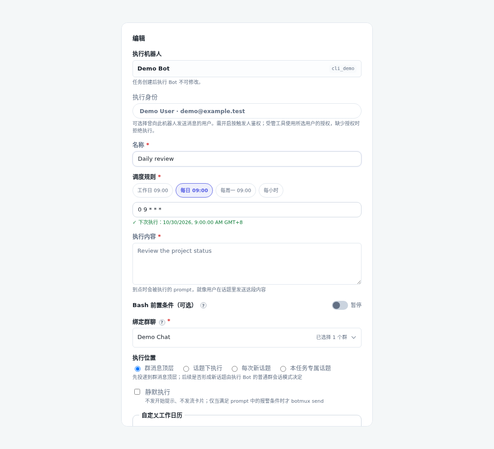
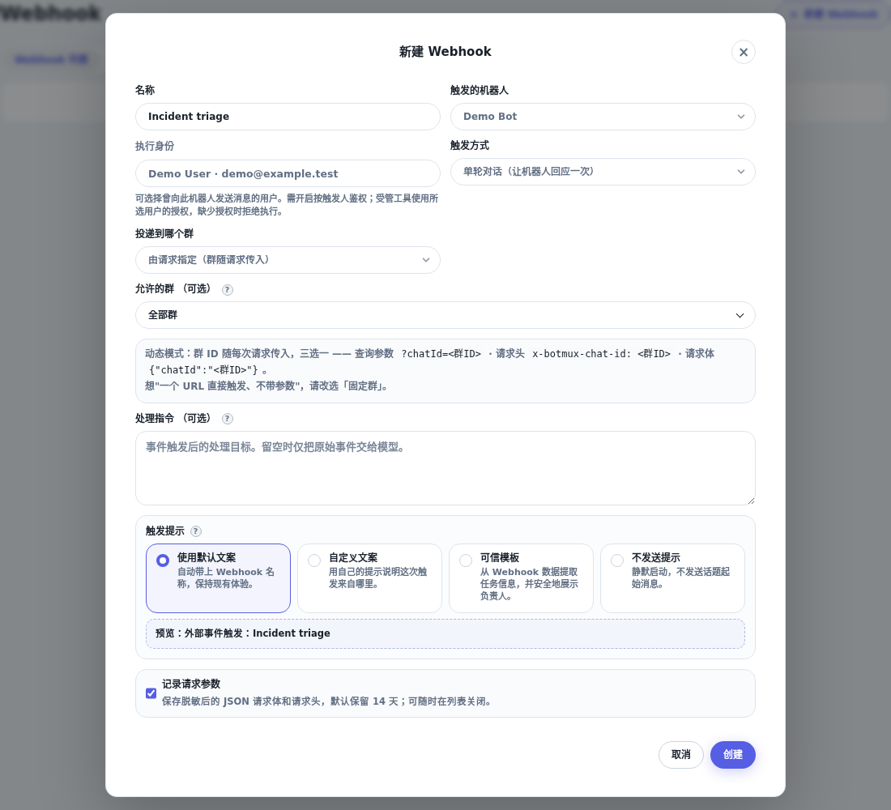

# Cron 与 Webhook 的执行身份

Dashboard 的定时任务及 Webhook 创建/编辑表单提供「执行身份 / Run as」。不选择用户时保持原有行为；选择后，每次执行携带该用户的身份，受管工具按现有本机个人授权或中心化平台授权取凭据，不复制凭据或借用机器账号。

候选人为曾向目标机器人发送消息的真人，包含历史会话 owner 和有真人发送者证据的回复者。单纯被 @、通讯录查询结果及机器人不作为使用记录。选项显示缓存的姓名、邮箱；没有姓名时显示 open_id。新消息事件持久化使用记录及 union_id，后续通讯录补全不覆盖使用记录。已有会话可补齐历史记录；既无发送记录也无保留会话的旧用户需要再次发送消息。

open_id 只在签发它的应用内有效，因此选项与保存的身份均绑定目标 Bot。切换 Bot 后重新选择；服务端只接受候选人的 open_id 并自行解析 union_id，忽略客户端传入的身份对象。Webhook 的 HTTP payload、headers、query 均不能指定执行者；目标 daemon 从保存的 connector 配置中读取选择。

## 前置条件与边界

执行身份不再要求 `triggerUserAuth.enabled`。能力按工具分别判定：

- `lark-cli`：显式托管应用绑定（`larkToolBinding: true`，现为显式 opt-in）本身就能执行 `--as user`，因此按触发人鉴权关闭时仍可使用 Run as。
- `bytedcli` / `larkdev`：仍要求该工具已由 `triggerUserAuth` 托管（这两个工具没有应用级 bot 身份，只有按人凭据）。

工具范围按以下优先级确定：Bot 的 `automationIdentity.tools`（若显式配置）→ `triggerUserAuth.tools`（若已开启）→ 仅 `lark-cli`。因此不会因为一个 Run as 选择静默打开全部个人工具。`fallback` 是兼容配置，当前凭据发布链路无论其值为 `bot-identity` 还是 `none`，在缺少用户凭据时均拒绝调用；选择执行用户不要求修改该全局配置。所选用户也必须满足目标 Bot 的操作权限；每次执行重新检查，撤销权限后后续运行拒绝执行。

显式配置但不可用（用户被撤权、无法解析、工具无法在该 Bot/后端上执行）时 **fail closed**：本轮不使用任何执行用户，受管工具拒绝调用，不会回退到任务创建者、拉群操作人、会话 owner 或本机登录。定时任务会因此让该次 dispatch 失败并记录错误，而不是静默换人执行。

身份作用于配置中的受管工具（lark-cli、bytedcli、larkdev；Codebase CLI 随 bytedcli）以及传给 CLI/受管执行链的可信请求者。它不切换操作系统账号、AI 模型供应商账号，也不接管独立 MCP 服务的认证。工具仍需相应用户授权、应用 scopes 及资源访问权限；没有授权会拒绝该工具调用。lark-cli 的 bot/user 角色语义沿用现有应用绑定规则。

支持本机受管 PTY/Tmux 家族及其受管 RPC 会话。不支持 adopt、外接 App Server 或远端后端，避免在没有受管凭据包装器的执行环境中静默使用宿主登录态。向已有会话注入时核对 Worker 启动时冻结的鉴权设置；设置尚未生效的 Worker 需要先重启。显式指定身份的 Webhook 不允许 steer 合入别人的执行。

## Bot 级默认执行身份与入群自动开工

Dashboard「Bot 默认设置 → 主动开工」提供同一套用户选择器，保存为 Bot 级 `automationIdentity: { user, tools, updatedAt }`。解析优先级：任务/Webhook connector 自己的 `runAsUser` → Bot 级默认 → 固定执行用户（`toolIdentity.defaultUser`）→ （按人鉴权开启时的）宿主验证过的来源（定时任务创建者）。各层只用于没有真人触发者的自动轮次。

- **入群自动开工**（`autoStartOnGroupJoin`）：在该开关下方选择「自动开工执行身份」。没有自动默认或固定执行用户时，首轮明确使用宿主机现有登录，即使普通消息开启了按触发人鉴权。选择用户后按 Bot 自动默认 → 固定执行用户的优先级执行，不从邀请者或 session owner 推断凭据用户。`bot.added` 的操作人只有经过独立真人验证才登记为 sender / session owner；已知 bot 和未知 ID 保留为事件参与者，不提供个人授权。首轮身份决策与工具基线按实际 turnId 冻结，后续真人轮次仍按发送者鉴权。显式开启的 lark-cli 应用绑定保持其独立的应用认证规则。
- **定时任务**：任务未选择执行用户时使用 Bot 级默认；`automationIdentity` 配置了但不可用时该次 fire 直接失败，不会退回创建者。
- **Webhook / 外部 trigger**：connector 未选择执行用户时使用 Bot 级默认。HTTP payload、headers、query 仍不能指定执行者。

显式配置的入群身份不可用时仍 fail closed：身份或工具能力校验失败会拒绝本轮开工，个人授权缺失时受管工具拒绝调用，不回退宿主登录。未配置是明确的宿主执行选择，不等于授权失败；包装器只接受 daemon 发布的当轮 host 记录，缺失材料与其它轮次仍拒绝。

## 兼容性迁移（旧 Bot）

2026-11-04 的部署把「`triggerUserAuth` 关闭且 `larkToolBinding` 未配置」的旧 Bot 从宿主机原生 lark-cli 凭据切换到了托管应用绑定，这是本次事件的根因。**2026-11-06 的统一身份策略修复（见 `docs/plans/2026-11-06-tool-identity-policy-refactor.md`）已把绑定改为显式 opt-in**：未配置 `larkToolBinding` 的 Bot 直接恢复宿主机原生行为，不再需要任何手工迁移；只有此前显式保存过 `larkToolBinding:true` 的 Bot 保持托管绑定。旧的「物化 `larkToolBinding:false`」兼容路径不再是必需步骤。

仍然适用的是：**推荐**路径——需要身份隔离的 Bot 保持（或显式开启）托管绑定，并为定时任务配置执行身份（`automationIdentity`）或固定执行用户（`toolIdentity`）。两种路径都需要重启会话或 `/restart` 让 worker 重新生成包装器。不要通过手改 `schedules.json` 来补身份；定时任务请用 Dashboard/`botmux schedule` 或 `automationIdentity`/`toolIdentity` 配置。

## 固定执行用户（toolIdentity）

Dashboard「Bot Defaults → 固定执行用户」（或 `toolIdentity: { defaultUser, tools, credentialSource }`）配置一位真人作为 Bot 的固定执行用户：

- 某工具的按触发人鉴权关闭时，普通会话内该工具以这位用户的身份执行（凭证来自其本人授权）。
- 自动轮次里它是**最低优先级**默认：任务/连接器自己的 Run as → `automationIdentity` → `toolIdentity` → （按人鉴权开启时的）已验证创建者/操作人 → 都没有时按工具基线执行（按人鉴权关闭即宿主机原生）。
- 配置了但不可用（跨应用、用户被撤权、无法解析）时该工具**拒绝调用**，不回退宿主登录或其它人。
- Worker 在 spawn 时按「按人鉴权工具 ∪ 固定用户工具」安装包装器：支持固定个人账号不需要全局打开按人鉴权；已运行中的会话需要 `/restart` 后才具备该工具的执行能力，生效前该工具维持原生行为并在日志中提示。

## 存储与生命周期

- 定时任务增加 `runAsUser: { larkAppId, openId, unionId, name? }`，保存在现有 host authority，并写入 JSON 投影及 canonical input。`ownerOpenId` / `ownerUnionId` 与 authority 的 control principal 继续记录创建者，编辑执行身份不改任务控制权。Delegated schedule 继续受原 grant 约束，不允许通过此字段替换身份。
- Bot 级默认保存在 bots.json 的 `automationIdentity`（仅 host 配置，不含凭据）。
- 每轮冻结 `automationUser` 及审计字段 `automationIdentitySource`（task / connector / bot_default / provenance / none）与 `automationIdentityTools`。Worker 的 managed turn origin 只携带冻结后的用户；队列、重启、recovery、模型切换与 native cron 续跑都不重新从“最后一条真人消息”推断身份。配置在已接受的轮次之后变更，只影响后续轮次。
- Webhook connector 使用同一 `runAsUser` 结构。创建/更新接口接受 `runAsOpenId`；空字符串/null 清除，省略保留原值。
- 每个执行轮次冻结身份，默认身份同样以 null 冻结。编辑任务或 connector 只影响未来执行，不改变已有队列、运行及 recovery 的身份；缺少必要快照时拒绝从任务的新配置推断执行者。
- Webhook 的可信请求者标注 `source: automation`，定时任务沿用 `schedule_creator` 来源及 taskId，供鉴权与审计区分自动触发和即时真人请求。
- Dashboard 用户列表接口 `/api/automation-users?larkAppId=...` 仅允许主机管理身份访问，经目标 daemon 读取该应用的历史，不返回凭据或 union_id。

## 验证

行为测试覆盖候选人筛选、跨应用隔离、缺少用户映射、兼容旧 fallback 配置且无凭据时仍拒绝、执行时撤权、旧 Worker 配置、每轮身份冻结、定时任务创建者与执行者分离、host authority 持久化及 delegated grant 不可替换。

在 preview 的隔离 checkout 中执行构建及相关测试。部署人工验证时在 preview/dev canonical 集成已验证改动后按仓库指南构建、认领与重启，核对实际进程、日志及 Dashboard；不修改 online。

## Dashboard 示意

使用隔离的虚构用户与表单数据在 preview Chromium 渲染。

## 本次验证记录（2026-10-29）

在 preview Linux、Bun 1.4.3 执行，基线为 dev 的 `0ad6e8911dcfbf755e282e8b4e62788a506911ab` 加本功能未提交改动。测试使用隔离 worktree、HOME 与 SESSION_DATA_DIR；依赖与 canonical 相同，使用 node_modules symlink，未执行 install。

- `bun run build`：通过，包含 TypeScript、脚本/测试桩类型检查、Dashboard bundle 与产物审计。
- `bun run test --maxWorkers 4 test/automation-identity.test.ts test/connector-api.test.ts test/dashboard-ipc.test.ts test/scheduler-authority-integration.test.ts test/scheduler-silent-execute.test.ts test/dashboard-public-redact.test.ts`：最终 515 通过、3 个已有用例跳过。
- `bun run test --maxWorkers 4 test/trigger-session-root-message.test.ts test/scheduler.test.ts test/identity-storage-model.test.ts test/identity-decision-flip.test.ts test/current-turn-provenance.test.ts`：269 通过。包含 Claude Code 的选人首轮派发和普通消息不继承 payload 身份。
- `v3-session-relay`、`xpi-shared-cwd-admission`、`scheduler-execution-context`、`identity-spawn-matrix`、`test-hygiene` 与公开数据脱敏相关测试通过。曾发现的 live/cold cron 鉴权拒绝后污染保留会话问题已修复；`scheduler-silent-execute` 重跑 78 通过。
- `bun run test:e2e test/automation-user-picker.e2e.ts test/dashboard-schedule-modal-layout.e2e.ts`：4 通过，截图使用虚构用户。Chromium 与共享库来自 preview 已有隔离目录，通过临时 PLAYWRIGHT_BROWSERS_PATH / LD_LIBRARY_PATH 指定。
- 38 个功能文件（含截图）与本地内容逐一 SHA-256 一致后，同步到干净的 preview/dev canonical，执行 `bun run switch:here && bun run daemon:restart` 成功。实际进程与日志确认 supervisor、daemon、Dashboard 从 dev canonical 的 dist 运行。
- 使用 preview 的 IPv6 Dashboard 验证：管理身份读取用户列表 HTTP 200，返回 3 位历史用户且不含 union_id；未认证读取 HTTP 401。未变更 online。

没有执行全量测试；macOS 实机、真实用户的第三方 OAuth/资源权限，以及真实 Cron/Webhook 业务任务的身份验证仍需人工完成。现有 Bot 的鉴权设置和用户授权不会被此功能自动修改。

### 兼容 fallback 配置的修复（2026-10-29）

移除选人入口及存活 Worker 对 fallback 必须为 none 的错误限制。当前凭据链路已不根据这一兼容字段回退机器身份；仍保留鉴权开启、受管工具、目标应用和用户权限校验。未修改任何 Bot 配置。

preview 隔离验证：相关 5 个单测文件 537 通过、3 个既有跳过；包含 bot-identity 配置下创建 Cron、选人和 lark-cli/bytedcli 实际 shell 包装器执行，以及缺少所选用户凭据时退出 77。完整构建与 4 个浏览器用例通过，截图已更新。

已在 preview/dev canonical 构建、认领并重启，实际 supervisor、daemon、Dashboard 在线。使用原有 bot-identity 配置只读校验 3 位历史候选人，3 位均成功解析。未变更 online。

## 本次身份回归修复验证记录（2026-11-06）

在 preview Linux、Bun 1.4.3 执行。隔离 checkout 基于 `feat/byte_approval/dev` 的 `d1ebf9097a0f5d11eaeff99b36d6d6383a94fa25`，`node_modules` symlink 到 preview canonical，未执行 install；HOME 与 SESSION_DATA_DIR 使用独立临时目录。

- `bun run build`：通过（tsc、脚本与测试桩类型检查、Dashboard bundle、domain/dist/embed 审计）。
- `bun run test --maxWorkers 4` 分三批、共 28 个相关文件：645 + 220 + 786 = 1651 通过，3 个既有用例跳过，0 失败。覆盖 automation identity resolver/config、入群 owner/participant 与自动化默认身份、scheduled provenance、scheduler、dashboard IPC/config/payload、connector API、turn CLI identity、lark-tool binding 与重启恢复。
- 以 patch SHA-256 `18ec11d5f056fcb32484af1abe4bef57db38ecff2f7ac97aee17eab805daa578` 集成到 preview 的 `feat/byte_approval/dev` canonical，执行 `bun run switch:here && bun run daemon:restart`。实际 supervisor（pid 3127839）、daemon（pid 3127857）与 Dashboard 均从该 checkout 的 `dist` 启动；23 个会话恢复，2 个 tmux worker 重新挂接，scheduler 启动 2/2 任务，日志无启动错误。
- Loopback IPC 只读验证：`GET /api/bot-default-oncall` 返回 200 且包含 `automationIdentity`；`PUT /api/bot-automation-identity` 空 body 返回 400 `no_valid_fields` 且未写 `bots.json`（mtime 不变）；`GET /api/automation-users` 返回 200。IPv6 Dashboard `http://[2605:340:cd52:700:bf87:dee0:bd61:d0ef]:7891/` 与 `/__health` 均返回 200。
- 未变更 online。preview 当前 Bot 未开启入群自动开工，本次未在飞书内实际触发群入群或定时任务；真实用户的 lark-cli 授权以及 Base/Wiki/Docx scopes 仍需按上文在人工验证中确认。

### 入群首轮身份发布补丁（2026-11-06 后续）

首轮部署后发现：`triggerUserAuth` 托管工具的身份快照在入群首轮没有按真实 turnId 发布——shared seed 与 `join_` 首轮的 `noteTurnReceived` 使用 `anchor`，且在 shared 路径 arm reply target 之前执行；auto-worktree / repo-card 路径则完全没有发布。结果是即使操作人是已验证真人，首轮 `lark-cli` / `bytedcli` / `larkdev` 仍可能读不到本轮身份（托管 lark 绑定不受影响，因为它在调用时从 managed turn origin 取 caller）。

修复：在 reply target 就绪后按 `ds.pendingTurnId ?? joinTurnId` 发布首轮身份；shared 路径先 arm 再发布；auto-worktree 与 repo-card 路径在返回前发布；显式冻结的 `automationUser: null` 不再回退到事件 sender。

preview canonical 修复后验证：相关 6 个测试文件 291 通过；`group-join-shared-routing.test.ts` 51 通过（新增“shared 首轮按 exact turnId 发布已验证操作人身份”用例）。重新构建并 `bun run use:here && bun run daemon:restart`；实际 supervisor（pid 3390802）、daemon（pid 3390820）自 2026-11-06T06:19:18Z 运行，Dashboard 在线。未变更 online。

### 复审补充修复（2026-11-06 后续）

针对复审提出的缺口补充修复：

1. **托管 Lark 绑定的工具边界**：绑定会话在 `/api/sessions/:sessionId/lark-tool-identity` 直接取用户 token，不经过 `publishTurnCliIdentity`。现在该入口与 `auth-request` / `auth-status` 都按本轮执行的冻结 `automationIdentityTools` 校验（`identityTurnId ?? turnId`）；异步 token 解析完成后再比对范围是否未变。范围排除 `lark-cli` 时返回 403 `automation_tool_scope_excluded`，不解析也不返回用户 token；没有 automation 快照的真人轮次保持原行为。
2. **无效默认身份保持显式状态**：`bots.json` 中配置但解析失败（跨应用、未知工具、空工具等）的 `automationIdentity` 不再被当成「未配置」。解析器返回带 `invalid` 的 sentinel，loader 记录 `automationIdentityInvalid`，resolver 对无效默认直接返回 `invalid_identity`，不会回退到任务创建者或入群操作人。Bot 仍正常启动，其它功能不受影响；Dashboard 保存路径用同一 parser 拒绝无效配置。
3. **显式 Run as 优先于 Bot 默认**：`executeScheduledTask` 把 `task.runAsUser` 作为 `explicit` 交给共享 resolver，只校验最终候选；被撤销的 Bot 默认不再阻断任务自己的有效选择。显式任务/connector 的工具范围也不受默认身份 `tools` 收窄。
4. **lifecycle 合成记录不作为候选人**：`chat.bot_added` 的入群记录带 `lifecycleSynthetic` 标记，不再产生 Run as 候选；旧记录没有独立真人证据（平台认证的 sender/contact 记录，或带 union_id 的 session owner）时同样排除。
5. **同轮缩窄工具范围时清除旧凭据**：`publishTurnCliIdentity` 遇到本轮不包含的工具时，调用 `clearSessionIdentity` 清除该工具已发布的身份材料，不只标记为 off。

补充验证（preview Linux、Bun 1.4.3，dev canonical `d1ebf9097` 加上述未提交改动）：

- 相关 5 个测试文件 217 通过、0 失败；构建通过。
- 全量 `bun run test`：2037 通过、2 跳过；12 个文件失败。用同一批失败文件在干净 `HEAD` 基线 worktree（`node_modules` symlink，未 install）复跑，同样 12 个文件失败，原因与本改动无关：root 下 chmod 权限断言失效、`/proc/<pid>/comm` 返回 `MainThread`、既有 `vi.mock` 与 `schedule-store` 漂移、Dashboard/浏览器与沙箱环境用例。身份相关用例无失败。
- 将复审目录中的 4 个补充测试文件复制到 canonical 临时运行（运行后删除）：213 个用例中 212 通过，复审新增的 5 项检查全部通过。唯一失败来自复审快照中继承的旧断言 `parseAutomationIdentityConfig(rawForeignApp).value === undefined`——它与同一文件新增的「无效默认不得回退到其它真人」检查互相矛盾（后者要求解析结果携带无效状态）。canonical 已按新契约把该旧断言改为 `isInvalidAutomationIdentity(...) === true`。
- `bun run switch:here && bun run daemon:restart` 成功；实际 supervisor（pid 3532096）、daemon（pid 3532114）、Dashboard（pid 3532115）自 2026-11-06T06:49:46Z 运行，`bun dist/cli.js status` 均为 online。IPv6 Dashboard `http://[2605:340:cd52:700:bf87:dee0:bd61:d0ef]:7891/` 返回 200，dist 包含 `automationIdentityInvalid`、`automation_tool_scope_excluded` 等新符号。
- 未变更 online；未在飞书内触发真实定时任务或入群 OAuth 业务轮次。

### 第二轮复审补充修复（2026-11-06 后续）

1. **无法执行的自动身份不再匿名放行**：Webhook/API trigger 解析 Bot 默认身份失败时，`triggerSessionTurn` 在 worker dispatch 前返回 `trigger_failed` / `automation_identity_unavailable:<reason>`。入群自动开工同样在创建会话前拒绝该轮，不再以「没有用户」继续执行——当工具强制包装本身缺失时，匿名轮次可能落到本机登录态，正是本次身份修复要消除的路径。
2. **委派定时任务保持匿名**：`authorizeDelegatedScheduleRun` 在返回的 task 上设置内存 symbol 标记，并剥离 `runAsUser`、`ownerOpenId`、`ownerUnionId`。`executeScheduledTask` 识别标记后跳过 Bot 默认、任务 Run as 与创建者 provenance，不生成 human trusted caller。symbol 随对象展开保留（follow-active、同一 fire 的恢复重入），但不会被 JSON 持久化；daemon 重启后 scheduler 从 authority record 重新授权并重新打标。委派工具仍由 `prepareDelegatedScheduledTurnIdentity` 按 grant scopes 单独发布。
3. **显式 Run as 的保存策略与 Bot 默认解耦**：`resolveAutomationUser` 接受可选的期望工具范围；任务、连接器与用户解析调用方默认使用 `explicitAutomationIdentityTools`，不再被 Bot 默认的旧 `tools` 阻断。Dashboard 默认身份保存改为先校验新请求的 tools，再把同一范围传给用户解析，因此可在一次请求中同时修复用户与工具范围。

补充验证（preview Linux、Bun 1.4.3，dev canonical `d1ebf9097` 加上述未提交改动）：

- 相关 6 个测试文件 341 通过、0 失败。
- 复审 round2 目录的 5 个补充测试文件：294 个用例 293 通过；3 项新增检查全部通过。唯一失败是复审快照继承的旧断言（`resolveAutomationUser` 仍按 Bot 默认 `tools` 期望 `bytedcli`），它与同轮新增的「显式选择使用独立 scope」检查冲突；canonical 已按新契约更新该断言。
- 全量 `bun run test`：2037 通过、2 跳过；仍为既有 12 个环境相关文件失败，失败文件与干净 `HEAD` 基线逐文件一致（root 下 chmod 权限断言、`/proc/<pid>/comm`、既有 mock/UI 环境），身份相关用例无失败。
- `bun run build` 通过；`bun run switch:here && bun run daemon:restart` 后实际 supervisor（pid 4126600）、daemon（pid 4126618）、Dashboard（pid 4126619）自 2026-11-06T07:42:04Z 运行并处于 online。
- 未变更 online；未在飞书内触发真实定时任务或入群 OAuth 业务轮次。
